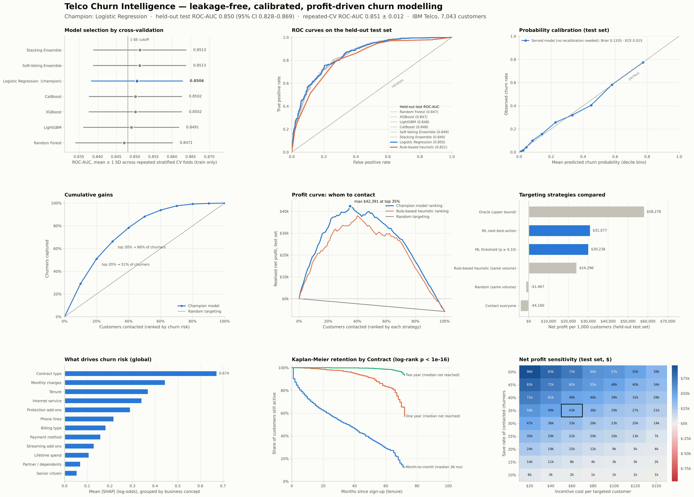
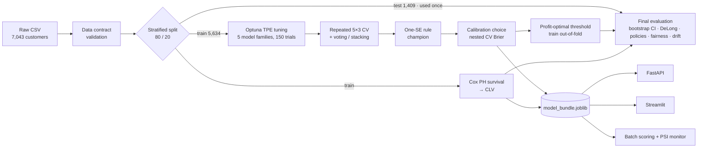

# Telco Churn Intelligence

**Leakage-free churn prediction → calibrated probabilities → survival-based customer lifetime value → profit-optimal retention actions, with reason codes, served over a REST API and a dashboard.**

   



## Results at a glance

All numbers come from `reports/metrics.json` and are measured on a **held-out test set of 1,409 customers that was never used for any modelling decision**.

| What | Result |
|---|---|
| Discrimination | **ROC-AUC 0.850** (95% bootstrap CI 0.828–0.869) · PR-AUC 0.673 · KS 0.55 |
| Stability | Repeated 5×3-fold CV ROC-AUC 0.851 ± 0.012 (training data only) |
| Targeting power | **2.9× lift** in the top risk decile · **66% of churners** found in the top 30% |
| Probability quality | Brier 0.134 · expected calibration error 0.015 (no post-hoc recalibration needed) |
| Thresholded (p ≥ 0.33, profit-optimal) | Recall 75.7% · precision 56.9% · F1 0.65 · accuracy @ 0.5: 80.9% |
| Versus v3's rule-based score | ROC-AUC 0.850 vs 0.821 (DeLong p = 5.6 × 10⁻⁶) |
| Business value* | Next-best-action policy: **$31,077 net per 1,000 customers**; contacting everyone: −$4,160 |
| Survival model | Cox PH test C-index 0.853 · month-to-month contracts: **10.3× the churn hazard** of two-year contracts |
| Engineering | FastAPI p50 / p95 latency 21 / 30 ms per customer incl. reason codes · ~12k customers/s in batch · 74 tests, 95.5% coverage · Docker · CI |

\* Under the explicit, configurable cost assumptions in [`configs/config.yaml`](configs/config.yaml) (see [Business layer](#5-business-layer-profit-not-accuracy)); the sensitivity grid shows the policy stays profitable across every save-rate × incentive scenario tested.

Full report: [`reports/RESULTS.md`](reports/RESULTS.md) · Model card: [`reports/model_card.md`](reports/model_card.md) · Resume material: [`reports/RESUME.md`](reports/RESUME.md)

---

## What the system does

For every customer it answers four questions:

1. **Will they churn?** A calibrated probability from a logistic-regression pipeline chosen out of seven Optuna-tuned candidates.
2. **What are they worth if we keep them?** Expected remaining lifetime from a Cox proportional-hazards model × monthly margin.
3. **What should we do?** The action with the highest expected profit: retention call, email offer or nothing.
4. **Why?** Exact SHAP contributions, grouped into business concepts ("Month-to-month contract", "Short tenure (1 month)", "High monthly bill ($95)").



## Quickstart

```bash
git clone <your-repo-url> && cd telco-churn-intelligence
python -m venv .venv && source .venv/bin/activate
make install            # requirements + editable package

make train-fast         # ~1 minute smoke run
make train              # full pipeline (~7.5 min on 2 vCPUs): tuning, CV, calibration, reports, figures
make ablate             # ablation studies (~2.5 min)
make test               # pytest + coverage

make api                # REST API  → http://localhost:8000/docs
make dashboard          # Streamlit → http://localhost:8501
docker compose up       # both, containerised
```

The dataset (IBM sample data, Apache-2.0) and a trained model bundle are included, so `make api` and `make dashboard` work immediately. The bundle was produced with the exact versions in [`requirements-lock.txt`](requirements-lock.txt) (Python 3.13). Install those for bit-for-bit reproduction, or run `make train` to rebuild the bundle under your own versions; the pipeline is seeded and deterministic.

### Score a customer

```bash
curl -s -X POST "localhost:8000/v1/predict" -H "Content-Type: application/json" -d '{
  "customerID": "DEMO-0001", "SeniorCitizen": 0, "Partner": "No", "Dependents": "No", "tenure": 3,
  "PhoneService": "Yes", "MultipleLines": "No", "InternetService": "Fiber optic",
  "OnlineSecurity": "No", "OnlineBackup": "No", "DeviceProtection": "No", "TechSupport": "No",
  "StreamingTV": "Yes", "StreamingMovies": "Yes", "Contract": "Month-to-month",
  "PaperlessBilling": "Yes", "PaymentMethod": "Electronic check",
  "MonthlyCharges": 98.5, "TotalCharges": 295.5}'
```

Real response from the trained model (abridged to two protective factors):

```json
{
  "customerID": "DEMO-0001",
  "churn_probability": 0.8245,
  "risk_tier": "high",
  "expected_remaining_months": 11.39,
  "clv_estimate": 673.19,
  "recommended_action": "retention_call",
  "action_description": "Retention specialist call + 1-month bill credit for moving to a 12-month contract",
  "expected_value": 141.43,
  "risk_drivers": [
    {
      "factor": "Contract type",
      "description": "Month-to-month contract",
      "impact": 0.7867,
      "direction": "increases_risk"
    },
    {
      "factor": "Monthly charges",
      "description": "High monthly bill ($98)",
      "impact": 0.5623,
      "direction": "increases_risk"
    },
    {
      "factor": "Tenure",
      "description": "Short tenure (3 months)",
      "impact": 0.499,
      "direction": "increases_risk"
    }
  ],
  "protective_factors": [
    {
      "factor": "Phone lines",
      "description": "Single phone line",
      "impact": -0.2517,
      "direction": "reduces_risk"
    },
    {
      "factor": "Senior citizen",
      "description": "Not a senior citizen",
      "impact": -0.0411,
      "direction": "reduces_risk"
    }
  ]
}
```

Check it by hand: EV = 0.8245 × 0.35 × (673.19 − 60) − 25 − (1 − 0.8245) × 60 = **$141.4** for the call, vs. $59 for the email, so the call wins.

Requests are validated against the training data contract: unknown categories, out-of-range values and impossible service combinations (e.g. `InternetService: "No"` with `OnlineSecurity: "Yes"`) return HTTP 422. A batch endpoint (`/v1/predict/batch`) scores up to 10,000 customers per call.

---

## Methodology

### 1. Leakage-free protocol
* One stratified 80/20 split. **The test set is scored exactly once**, after every decision has been made.
* Feature engineering is a fitted scikit-learn transformer inside the pipeline, so statistics such as the `HighSpend` quantiles are learned per CV fold, and single-row inference uses the training quantiles (in v3, single-customer inference always produced `HighSpend = 0`).
* Tuning, model selection, calibration choice, decision thresholds and the survival model all use training data only, via cross-validation or out-of-fold predictions.

### 2. Models and tuning
Logistic regression, random forest, XGBoost, LightGBM and CatBoost are tuned with Optuna (TPE sampler, median pruning across folds, defaults enqueued as the first trial), followed by soft-voting and stacking ensembles of the top three. For logistic regression the penalty is chosen with a **paired one-standard-error rule**: the strongest regularisation whose fold-wise AUC is statistically tied with the best trial (glmnet's `lambda.1se` idea, made sharper by pairing folds).

### 3. Champion selection: why logistic regression
| Model | CV ROC-AUC | Test ROC-AUC | DeLong p vs champion |
|---|---|---|---|
| Stacking ensemble | 0.8513 ± 0.0124 | 0.8492 | 0.63 |
| Soft-voting ensemble | 0.8513 ± 0.0124 | 0.8490 | 0.61 |
| **Logistic regression** | 0.8506 ± 0.0122 | **0.8497** | — |
| CatBoost | 0.8502 ± 0.0124 | 0.8478 | 0.36 |
| XGBoost (tuned to depth 2) | 0.8502 ± 0.0124 | 0.8470 | 0.17 |
| LightGBM | 0.8491 ± 0.0128 | 0.8478 | 0.46 |
| Random forest | 0.8471 ± 0.0130 | 0.8468 | 0.35 |

The ensembles beat logistic regression by only +0.0008 AUC in CV, well inside the one-standard-error band (ESL §7.10), and on the test set logistic regression is in fact the top scorer. Optuna also drove XGBoost to depth-2 trees, a sign that churn signal in this dataset is close to additive. So the simplest model ships: one model instead of three, exact SHAP explanations and millisecond inference.

### 4. Calibration
Platt (sigmoid) and isotonic calibration were compared against no calibration using nested CV on the training data. The unweighted logistic model was already well calibrated (out-of-fold ECE 0.0105), so no recalibration layer is served. The ablation below shows why v3's `class_weight="balanced"` and SMOTE were removed: they leave AUC unchanged but inflate probabilities about 5× in calibration error.

### 5. Business layer: profit, not accuracy
Campaign profit follows the decomposition of Neslin et al. (2006), also used by Verbraken et al. (2013) for the EMP metric. For a contacted customer with churn probability *p* and value-if-retained *CLV*, using an action with contact cost *c*, incentive *d* and save rate *g*:

```
expected value = p · g · (CLV − d)  −  c  −  (1 − p) · d
```

* **Realised profit on the test set credits value only for customers who actually churned.** v3 applied an 87% "save rate" to every low-risk customer, which inflated ROI.
* **Next-best-action:** each customer gets the action with the highest positive expected value (call: $25 contact + $60 credit, 35% save rate; email: $2 + $20, 12%), or no action.
* **Thresholds** are tuned on training out-of-fold predictions. The optimum moves from 0.19 to 0.33 to 0.48 as the incentive rises from $30 to $60 to $120.

| Policy (held-out test set, 1,409 customers) | Contacted | Churners reached | Net profit | Per 1,000 customers |
|---|---|---|---|---|
| Contact everyone | 100% | 100% | −$5,862 | −$4,160 |
| Random targeting, same volume as ML | 35% | 35% | −$2,068 | −$1,467 |
| Rule-based heuristic (v3 score), same volume | 35% | 71% | $34,233 | $24,296 |
| ML threshold policy (p ≥ 0.33) | 35% | 76% | $42,605 | $30,238 |
| **ML next-best-action** | 45% | 79% | **$43,787** | **$31,077** |
| Oracle (perfect foresight, upper bound) | 27% | 100% | $82,113 | $58,278 |

### 6. Survival-based CLV
A Cox proportional-hazards model is fitted on (tenure, churn) with contract, services, billing and price covariates; tenure and TotalCharges are excluded because they *are* the duration. Expected remaining months within a 24-month horizon, conditional on the months already survived, gives `CLV = 60% margin × monthly charge × E[remaining months]` (mean $747 on the test set). After fitting, the model is reduced to numpy arrays (baseline survival curve and coefficients), so serving does not need `lifelines`; a unit test checks it against lifelines to 1e-6.

### 7. Explainability
Exact SHAP values (linear model: β·(x − E[x]) in log-odds) are summed into 13 business concepts. Two changes keep reason codes coherent:
* v3 features such as `Fiber_x_Charge`, `NumServices` and `ServiceDensity` were dropped. MonthlyCharges is almost a linear function of the subscribed services (R² ≈ 1), so these features let the model learn large offsetting weights, producing reasons like "$95 bill *lowers* risk by 1.4". Removing them changed CV AUC by < 0.001.
* Descriptions are driven by the customer's actual values, so a $95 bill is never described as "low".

### 8. Fairness, monitoring and governance
* `gender` is excluded from the inputs: the ablation shows it carries no signal. Gender gaps are small (TPR gap 0.04, selection-rate ratio 0.98). Senior citizens are selected about twice as often, which tracks their roughly 2× base churn rate. This is documented in the [model card](reports/model_card.md), since the action is a benefit (a retention offer), not an adverse decision.
* **Drift monitoring:** PSI on every input and on the score. Held-out test vs. training reference: max PSI 0.012 (stable). A simulated +15% price rise with contract lapses triggers an alert on MonthlyCharges (PSI 0.85). `scripts/monitor_drift.py` exits with code 2 on alerts so it can gate a scheduled job.

## Ablation studies (paired, repeated 5×3-fold CV on the training split)

| Experiment | Logistic regression | LightGBM |
|---|---|---|
| Domain features removed (raw inputs only) | ΔAUC **−0.0051 ± 0.0009** | ΔAUC +0.0003 ± 0.0003 (trees learn them) |
| `class_weight="balanced"` | ΔAUC +0.0001 · Brier **+21%** · ECE 0.029 → 0.147 | ΔAUC −0.0002 · Brier +20% |
| SMOTE inside each fold | ΔAUC −0.0011 · Brier **+20%** · ECE 0.029 → 0.137 | ΔAUC **−0.0029** · Brier +11% |
| Gender included | ΔAUC −0.0003 (negligible) | ΔAUC +0.0003 (negligible) |

Reweighting and oversampling do not help *ranking*, and they damage the probabilities that expected-value decisions multiply by dollars.

## What changed from v3, and why it matters

| v3 behaviour | Problem | v4 |
|---|---|---|
| Best model picked by **test** AUC; profit threshold tuned on **test** | Optimistic, selection-biased results | CV/out-of-fold on train for every decision; test used once |
| 20% validation split created but never used | Wasted data | 5×3 repeated CV on 80% train |
| `HighSpend`/`LowSpend` quantiles from the full dataset, and from the single request at inference | Leakage, plus train/serve skew (`HighSpend` always 0 in production) | Fitted transformer; parity unit-tested |
| 5-fold CV run on all rows (incl. test) without SMOTE; test models trained with SMOTE | Inconsistent, partly leaky estimates | One protocol; SMOTE evaluated in-fold as an ablation |
| `cv_models["Stacking Ensemble"] = best["pipe"]` | Mislabelled CV results | Each model evaluated on identical folds |
| ROI applied save rates (up to 87%) to **all** customers in a tier × full CLV | Inflated ROI that would not survive an interview | Neslin profit model; value credited only for actual churners |
| CLV = average monthly × average tenure (historical revenue) | Not a forward-looking value | Cox survival expected remaining months × margin |
| Balanced class weights + SMOTE probabilities fed into $ decisions | Mis-calibrated expected values | Unweighted, calibration verified (ECE 0.015) |
| "Improvement from ML: +x%" computed as AUC × 100 (percentage points) | Mislabelled metric | AUC difference with DeLong test and CI |
| Feature importance of the stacking model taken from one base learner | Explained the wrong model | SHAP of the served pipeline, grouped into concepts |
| One script, no tests | Hard to trust or deploy | Package, API, dashboard, Docker, CI, 74 tests |

## Project structure

```
telco-churn-intelligence/
├── configs/                 # config.yaml (all knobs & business assumptions), config.fast.yaml (CI)
├── data/raw/                # IBM Telco CSV (Apache-2.0) + data dictionary
├── data/sample/             # 25 customers for batch-scoring demos
├── src/churnintel/
│   ├── data/                # loading, schema, data-contract validation
│   ├── features/            # TelcoFeatureEngineer (sklearn transformer), preprocessing, v3 heuristic
│   ├── models/              # model zoo, Optuna tuning, CV + 1-SE selection, calibration
│   ├── evaluation/          # metrics, bootstrap CIs, DeLong test, fairness audit
│   ├── business/            # expected value, next-best-action, policies, sensitivity
│   ├── survival/            # Cox PH → survival CLV, Kaplan-Meier
│   ├── explain/             # SHAP + concept-level reason codes
│   ├── monitoring/          # PSI drift monitor
│   ├── viz/                 # figure style + all report figures
│   ├── inference.py         # ChurnPredictor (shared by API, dashboard, batch jobs)
│   ├── pipeline.py          # end-to-end training orchestration
│   └── reporting.py         # RESULTS.md / model_card.md / RESUME.md from JSON
├── api/                     # FastAPI app + pydantic data contract
├── app/streamlit_app.py     # what-if, batch scoring, campaign simulator, model report
├── scripts/                 # train, ablations, batch_score, monitor_drift, benchmark_api, build_notebook, …
├── tests/                   # 74 tests: features, metrics, DeLong, economics, survival, API, app, pipeline
├── notebooks/               # executed EDA + results walkthrough
├── artifacts/               # model_bundle.joblib + metadata
├── reports/                 # metrics.json, CSVs, RESULTS.md, model card, figures/
├── Dockerfile · docker-compose.yml · Makefile · pyproject.toml · .github/workflows/ci.yml
```

## Limitations and next steps
* **Save rates and costs are assumptions.** Measuring them needs a randomised retention experiment. The natural next step is uplift modelling (T-/X-learners) to target customers whose behaviour the offer actually changes, rather than those most likely to leave.
* Single snapshot with no timestamps, so no out-of-time validation is possible. Production use would need a rolling backtest.
* The Cox proportional-hazards assumption is approximate for contract type; a stratified Cox or time-varying-effects model is a natural extension.
* The Dockerfile and compose file are included and CI builds the image. In the environment where this was produced, the Docker registry was not reachable, so the image was not built locally.

## References
* Neslin, S. A., Gupta, S., Kamakura, W., Lu, J., & Mason, C. H. (2006). Defection detection: Measuring and understanding the predictive accuracy of customer churn models. *Journal of Marketing Research*, 43(2), 204–211.
* Verbraken, T., Verbeke, W., & Baesens, B. (2013). A novel profit maximizing metric for measuring classification performance of customer churn prediction models. *IEEE Transactions on Knowledge and Data Engineering*, 25(5), 961–973.
* DeLong, E. R., DeLong, D. M., & Clarke-Pearson, D. L. (1988). Comparing the areas under two or more correlated ROC curves: a nonparametric approach. *Biometrics*, 44(3), 837–845.
* Sun, X., & Xu, W. (2014). Fast implementation of DeLong's algorithm for comparing the areas under correlated ROC curves. *IEEE Signal Processing Letters*, 21(11), 1389–1393.
* Cox, D. R. (1972). Regression models and life-tables. *Journal of the Royal Statistical Society: Series B*, 34(2), 187–220.
* Lundberg, S. M., & Lee, S.-I. (2017). A unified approach to interpreting model predictions. *NeurIPS*.
* Hastie, T., Tibshirani, R., & Friedman, J. (2009). *The Elements of Statistical Learning* (2nd ed.), §7.10.
* Akiba, T., Sano, S., Yanase, T., Ohta, T., & Koyama, M. (2019). Optuna: A next-generation hyperparameter optimization framework. *KDD*.
* Mitchell, M., et al. (2019). Model cards for model reporting. *FAT\* '19*.

## License
Code: MIT. Data: IBM Telco Customer Churn sample, Apache-2.0 (see [`data/raw/README.md`](data/raw/README.md)).
